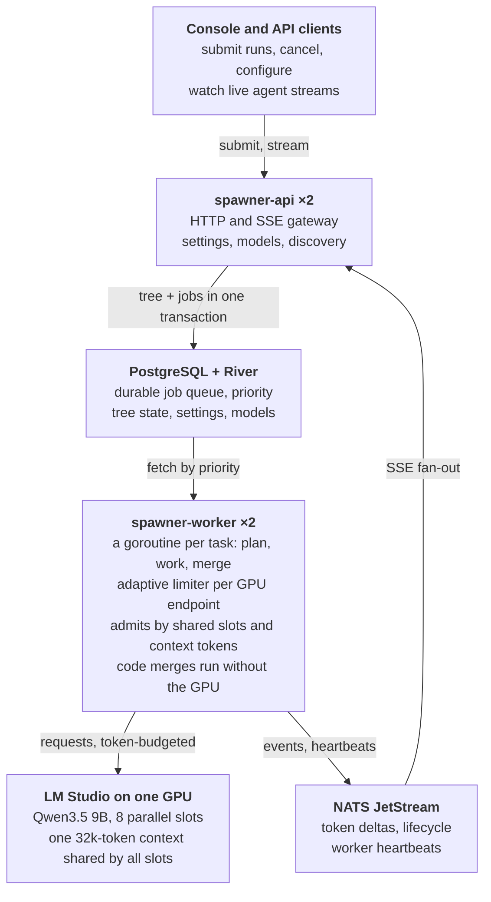

# Parallel Agents on Local LLMs: Chunked Context, Code Merges, and Shared-Context Admission

October 12, 2026 · go-agent-spawner

## Abstract

Splitting a long input across four parallel agents and merging their answers in code is 51–65% faster than giving one agent the whole input. It found all 30 planted facts in 21 of 21 runs and keeps working past the model's context limit. One large context found every fact in only 9 of 17 runs and failed outright above 32k tokens. We measured this on a single consumer GPU (RTX 4080 SUPER, 16 GB) running Qwen3.5 9B through LM Studio, with a goroutine-based agent spawner on Kubernetes.

The gain depends on how results are merged. When a model writes the merged answer, it regenerates the whole output serially, and chunking becomes about 40% slower than a single context despite being more accurate. Merging list-shaped answers in code removes that cost entirely.

We also report the system's capacity limits and the operational failure modes found under test. The most consequential: LM Studio shares one context across all parallel slots. Safe parallelism therefore needs admission control by token budget, not just by request count.

## Introduction

Local inference makes a single GPU the scarce resource. Requests are cheap to issue and expensive to serve, and an inference server batches several requests at once. So the question isn't how many agents you can start, but how to keep the GPU's parallel slots full without overloading them.

Our goal was a tight feedback loop: the user sees useful output within seconds, and large tasks are split across agents that run at the same time. We built an agent spawner to test this and asked three questions:

1. Where are the capacity limits of one local GPU under concurrent agents?
2. Is splitting a long input across parallel agents faster or more accurate than one long context?
3. What fails in practice, and what does the system need to survive it?

## System architecture

The spawner separates durable control from live data: PostgreSQL (through River) owns what runs and in what order, while goroutines and NATS move tokens without touching the database.

A run is a tree. A planner either answers directly or splits the task; in document mode, code splits the input with no planner. Children run in parallel, and the last one to finish enqueues the parent's merge in the same transaction, so a crash never orphans work. Each worker caps requests per GPU endpoint with an adaptive limiter. Before admitting a request it also checks two pool-wide budgets shared with the other workers over NATS: the server's parallel slots and its shared context tokens. Merges run either as a model call or in code (`list`: distinct lines; `concat`: verbatim), and code merges take no GPU slot.

## Methodology

All tests ran on the deployed system through its public API, one GPU, with timings taken end to end from submission to final event.

| Component | Configuration |
| --- | --- |
| GPU | NVIDIA RTX 4080 SUPER, 16 GB |
| Inference server | LM Studio, 8 parallel slots, 32,000-token context shared across slots |
| Model | Qwen3.5 9B, Q8_0, reasoning off (`reasoning_effort: "none"`) |
| Orchestration | Go spawner 0.1.3–0.1.8, 2 worker replicas, River on PostgreSQL 17, NATS JetStream |
| Cluster | 3-node Kubernetes 1.33 on a home LAN |

**Chunking experiment.** Each synthetic document plants 30 facts (`<service> listens on port <n> and is owned by the <team> team`) evenly through engineering-prose filler. The task asks for every fact as `service | port | team`. Recall is the share of the 30 facts returned exactly; a hallucination is a listed service that does not exist.

Documents ranged from 2.4k to 65k tokens. Conditions: one agent with the whole document (single context); the document split in code into 4 or 8 parts, one agent each, merged by a model or in code. Runs executed one at a time so latency isn't confounded by load. Each size had 3 repetitions up to 24k tokens and 2 above, each with different fact positions. 153 runs in total; 84 valid runs form the v2 results.

**Capacity tests.** Up to 40 simultaneous runs, fan-outs of 4–16 agents, and forced nesting to depth 3, with the limiter state sampled every second.

## Capacity limits

The GPU's ceiling for this model is about 150 tokens per second, reached only when the server has 8 parallel slots and the spawner fills all of them.

*Throughput stops growing at the server slot count.* Combined output in tokens per second, by number of runs submitted at once (`experiments/stress`):

| Runs at once | 4 server slots (tok/s) | 8 server slots (tok/s) |
| --- | --- | --- |
| 1 | 49.0 | 50.3 |
| 2 | 76.0 | 79.1 |
| 4 | 107.2 | 118.1 |
| 6 | 92.9 | 102.8 |
| 8 | 97.4 | 118.7 |
| 12 | 112.1 | 107.7 |
| 16 | 112.3 | 120.2 |
| 40 (sustained burst) | 108.9 | **149.8** |

With 4 slots, throughput plateaued at about 110 tok/s from 4 concurrent runs upward. Extra runs only queued, and the worst wait for a first token reached 6–7 s. Raising the server to 8 slots cut that worst wait to under 1.5 s and raised sustained throughput by 27–38%. In short ladder tests the spawner itself was the cap: its limiter started at 2 slots per worker and hadn't climbed to 8 before each test ended. Starting each worker at its share of the slots fixed that.

Wide splits hit a different limit: the planner and the merge each run as one stream, and both grow with fan-out.

| Agents per split | Planning | Parallel work | Model merge | Total |
| --- | --- | --- | --- | --- |
| 4 | 11 s | 8 s | 4 s | 23 s |
| 8 | 17 s | 13 s | 25 s | 55 s |
| 12 | 17 s | 20 s | 26 s | 63 s |
| 16 | 32 s | 24 s | 41 s | 97 s |

At 16 agents, planning and merging took 73 of 97 seconds. Nesting worked when requested: a forced depth-3 tree of 40 agents (27 workers, 13 merges) completed in 131 s with every merge firing exactly once. The planner never nested on its own.

## Chunked agents vs one long context

Four agents with a code merge took 4.1–12.6 s at every size, 51–65% faster than one context wherever one context could run at all.

*Four agents with a code merge are fastest at every document size.* End-to-end seconds per run (mean of 2–3 runs) and recall (`experiments/chunking/results_v2.json`):

| Document tokens | One context | 4 agents, model merge | **4 agents, code merge** | 8 agents, code merge | 4 agents (code merge) vs one context |
| --- | --- | --- | --- | --- | --- |
| 2.4k | 9.3 s · 1.000 | 13.2 s · 1.000 | **4.1 s · 1.000** | 5.5 s · 1.000 | 55% faster |
| 5.9k | 9.8 s · 1.000 | 14.3 s · 1.000 | **4.3 s · 1.000** | 6.4 s · 1.000 | 56% faster |
| 11.3k | 11.2 s · 1.000 | 15.3 s · 1.000 | **4.3 s · 1.000** | 7.6 s · 1.000 | 62% faster |
| 18.6k | 11.4 s · 0.856 | 17.3 s · 1.000 | **4.6 s · 1.000** | 9.3 s · 1.000 | 60% faster |
| 24.3k | 13.8 s · 0.922 | 19.3 s · 1.000 | **4.9 s · 1.000** | 9.8 s · 1.000 | 65% faster |
| 29.4k | 14.2 s · 0.900 | 22.0 s · 1.000 | **6.9 s · 1.000** | 14.8 s · 1.000 | 51% faster |
| 43.8k | fails (> 32k context) | 26.3 s · 1.000 | **11.1 s · 1.000** | 18.8 s · 1.000 | only option |
| 65.4k | fails (> 32k context) | 30.6 s · 1.000 | **12.6 s · 1.000** | 21.2 s · 0.967 | only option |

The model merge is what made chunking slow in our first run: it regenerates the whole answer serially, a fixed cost of about 8.5 s here. Eight agents were slower than four: more repeated instructions, and eight streams sharing one GPU.

Accuracy separates the conditions as clearly as speed:

| Condition | Runs | All 30 facts found | Hallucinated facts | First output (median) |
| --- | --- | --- | --- | --- |
| One context | 21 (17 fit the context) | 9 | 1 | 11.2 s |
| 4 agents, model merge | 21 | 21 | 0 | 5.3 s |
| **4 agents, code merge** | **21** | **21** | **0** | **2.6 s** |
| 8 agents, code merge | 21 | 19 | 1 | 4.9 s |

One context's recall fell from 1.0 to 0.86–0.92 between 18k and 29k tokens, missing facts from the middle of the document. Every agent in the chunked runs read at most about 16k tokens.

## Operational failure modes

The most expensive lesson: LM Studio's context is one pool shared by all parallel slots, so admitting requests by count alone overflows it. Each issue below was found by testing the running system, and each fix was verified the same way.

| Failure | Symptom | Fix | Verified by |
| --- | --- | --- | --- |
| Shared context pool | Four 10.7k-token chunks at once (43k) exceed the 32k pool; the server fails them mid-stream with code 500 "Context size has been exceeded" | Token-budgeted admission for models marked `shared_context`, counted across all workers; short retry on overflow that doesn't use up an attempt | Simulated pool: overflows recovered without the budget, zero with it; 43k and 65k documents at recall 1.0 |
| Error misclassification | Treating that 500 as permanent (by keyword) lost every chunk of 43k and 65k documents (recall 0) | Classify by the embedded status code before any keyword; only a request larger than the whole context is permanent | Unit tests on LM Studio's exact payloads; reruns at recall 1.0 |
| Silent truncation in the merge | With a 16k context, a 12-chunk merge input of 14k tokens dropped one of 12 topics, with no error | Merge size guard: consolidate in parallel batches when inputs exceed the context; visible truncation markers | Topic missing at 16k, present at 32k; batching tests |
| Estimates used for permanent decisions | A chars ÷ 4 estimate (35k) rejected a 28k-token request the server would have accepted | Estimates only delay admission (an oversized one waits for an idle pool); the server makes the final call | Single-context 28k runs succeed again |
| Latency read as congestion | Under 8-way batching TTFT rises about 2.5×; the limiter cut capacity from 8 to 5.3 slots (132 tok/s, 62.7 s burst) | With known server slots, back off only on errors | Limit holds at 8 slots: about 150 tok/s, 54.8 s burst |
| Refused connections during rollouts | Requests refused for a few seconds on every deploy | 5 s `preStop` sleep before shutdown | 331 of 331 requests succeeded during a rolling restart |
| Clicks lost in live views | A cancel button redrawn every 150 ms never received a human-speed click | Controls built once and updated in place | Browser test with 180 ms press-release clicks |

Two patterns recur. A system can look healthy while losing data, so tests must score outputs, not just completion. And any heuristic (a keyword, an estimate, a latency threshold) needs a check that it can only delay or retry, never cause a permanent failure.

## Applications

The pattern fits work that splits into independent parts whose results can be combined: wide reading, extraction, per-unit generation. It fits poorly where the answer depends on reasoning across parts. The spawner is reachable over HTTP/SSE, so it can sit behind a chat UI, a coding agent or another agent as a tool.

| Use | How it maps | Suggested setup | Fit and caveats |
| --- | --- | --- | --- |
| Agentic coding | Fan out over files or modules: summarize a repo, review a diff per file, generate tests per package, apply a mechanical migration | Planner split or document mode per file; `concat` merge for code; `list` for findings | Strong for independent per-file work. Cross-file refactors need one context or a model merge that reconciles |
| Coding agent's helper tool | A larger agent (cloud or local) calls the spawner to read many files or logs in parallel and gets back a merged digest | Expose "run tree" as a tool (for example over MCP); document mode, 4 chunks, `list` merge | Strong: offloads bulk reading to a local GPU, keeping cost low and data on-premises |
| Chat interface | Long pasted documents, transcripts or logs answered in parallel, with live streaming and per-agent progress | Single context below about 6k tokens; document mode above that; reasoning off for the planner | Strong for long-input Q&A and extraction (first output in about 2.6 s). No gain for short conversational turns |
| Agent as a service | Other systems submit trees by API with priorities; results are retrieved by tree ID or streamed | P1 for interactive work, P3–P4 for background; shared slots and context set per model | Strong: durable queue, cancellation, survives restarts |
| Document and knowledge ingestion | Extract entities, facts or summaries from long documents to feed search or RAG indexes | Document mode, `list` merge; 4 chunks per GPU with 8 slots | Strong: the experiment's own task. Validate output formats; agents vary them |
| Log and incident analysis | Scan logs far larger than one context for errors, timelines or anomalies | Document mode, `list` or `concat` merge | Strong: 2× the context worked with no loss. Correlating events across chunks needs a model merge |
| Research and reports | Planner splits a topic into sections written in parallel, then a model merge writes the report | Planner split, `llm` merge, fan-out 4 | Moderate: accurate and parallel, but the model merge costs time on long outputs |
| Batch and CI jobs | Nightly reviews, documentation regeneration, evaluation runs | Low priority, queue-driven worker scaling (KEDA) | Strong: River's durability suits long queues; the GPU is the cap |

**Rule of thumb.** If the answer is a list, a set of sections or per-item results, split and merge in code. If it is one argument built from all parts, split for reading but merge with a model, or use one context when the input fits.

## Limitations and future work

The results hold for one task type on one model and one GPU, so they bound the claim rather than generalize it.

- **One task type.** Needle-style extraction favors chunking. Tasks that need reasoning across distant parts of a document may lose accuracy when split.
- **One model and GPU.** A larger or slower-prefilling model would likely favor chunking more on latency; that is untested.
- **Small samples.** 2–3 repetitions per cell. The trends are consistent across sizes, but single cells have wide intervals.
- **Synthetic documents.** The filler is repetitive. Real documents may be easier or harder for long-context attention.
- **Token estimates.** Admission uses characters ÷ 4 plus reserved output. That is conservative for prose and optimistic for dense code; the server's overflow error remains the backstop.
- **No authentication** on the console or API yet.

Next steps, in priority order: repeat the experiment on cross-chunk reasoning tasks; measure a larger model on the same GPU; count tokens with the model's tokenizer instead of estimating; add a validated merge for structured outputs (schema-checked JSON rows).

## Conclusion

On a single local GPU, parallel agents beat one long context on speed, accuracy and capacity at once, provided three conditions hold. The input splits into independent parts; the merge is done in code wherever the answer is list-shaped; and admission respects the server's shared context, not just its slot count. Without the code merge, chunking trades speed for accuracy. Without token-aware admission, it fails at exactly the sizes where it matters most.

### Reproducibility

| Item | Location |
| --- | --- |
| Spawner source and deployment | `go-agent-spawner` repository; image `ghcr.io/biodigitaljaz/agent-spawner:0.1.8` |
| Chunking harness | `experiments/chunking/chunk_experiment.py` (conditions such as `1,4,4L,8L`) |
| v2 results (84 runs) | `experiments/chunking/results_v2.json` |
| v1 results (69 runs, model merge only) | `experiments/chunking/results.json` |
| Capacity harnesses | `experiments/stress/stress.py`, `nest.py`, `ctx.py` |
| Detailed write-up | `experiments/chunking/RESULTS.md` |
